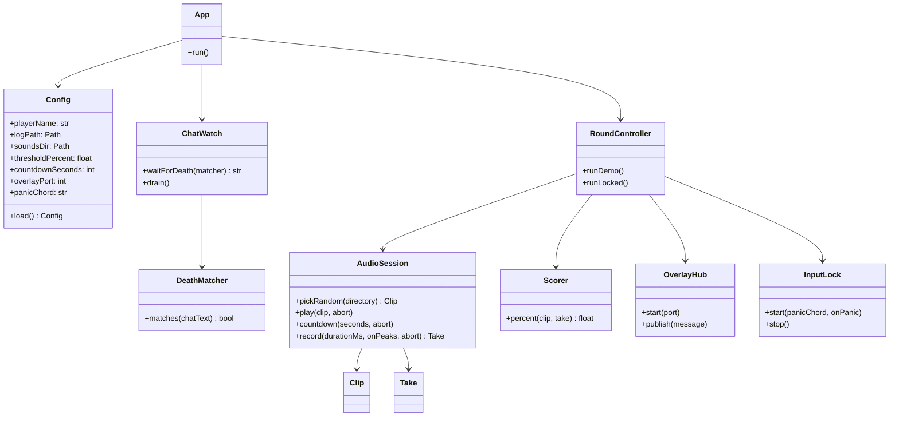
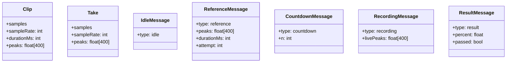
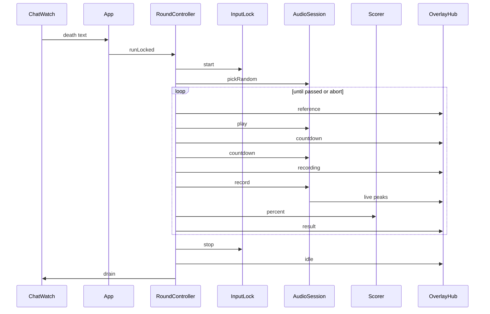
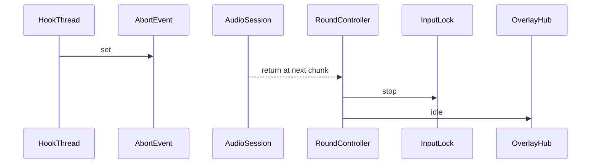

# Granular Minecraft sound challenge

This replaces [minecraft_sound_challenge_6adab26b.plan.md](c:\GitHubProjects\sound-immitation.cursor\plans\minecraft_sound_challenge_6adab26b.plan.md). Behavior is unchanged: tail the Java log, lock input on your death, play a random clip, tick for 3 seconds, record the mic, and retry until a score passes. Implementation stops after each iteration below so you can run it and refactor before the next layer exists.

The `.cursor/rules` CMS and Next.js conventions do not apply. English identifiers, deep modules, no markdown files.

## Iterations

Each iteration adds files but does not reach into the next one. Later iterations call the public methods below and do not reimplement them.

1. **Listen.** Classify live chat. No audio, no overlay, no lock.
2. **Score.** Play, countdown, record, print the percentage. One attempt, no lock, no overlay. This is where the formula is allowed to change.
3. **Overlay.** The same one attempt, drawn in a browser and then in OBS.
4. **Lock.** Panic-key test for a few seconds, then the full retry loop with input swallowed until the score passes.

## Classes

One deep module per file. Callers see the methods on the diagram, not sample rates, log prefixes, or hook handles.

Data the round passes around. `peaks` is always 400 numbers in `0..1`, so the overlay and the file format stay independent.

`RecordingMessage.livePeaks` uses `null` for columns that have not been recorded yet. The grey reference stays full width. The live trace only draws filled columns, left to right, on that same width.

## Sequences

One passing attempt. `runLocked` keeps the loop going when `passed` is false. `runDemo` leaves after a single result and never starts the lock.

Panic is not a special case inside play or record. The hook thread only sets an `abort` event. Audio returns at the next chunk, the round `finally` stops the lock, and the hub gets `idle`.

## Threads

- The asyncio loop only runs `OverlayHub`.
- `ChatWatch` blocks on the file. When a death matches, it calls `runLocked` on that same thread, so a second death cannot start a second round.
- After the round, `drain` seeks to the end of the log and drops deaths that happened while input was locked.
- Play and record run on that round thread, in chunks of about 50ms, and check `abort` between chunks.
- `publish` may be called from the round thread. The hub marshals onto the asyncio loop with `call_soon_threadsafe`.
- The hook thread runs `GetMessage`. The hook procedure only reads modifier state and sets `abort`. It does not play audio, score, or take locks.

## Contracts to implement, not invent

### Chat line

Take the text after the last `[CHAT] ` on the line. Ignore lines without that marker. Strip a leading `[Not Secure] ` and any `§` color codes.

`DeathMatcher.matches`:

- Reject text that contains `has made the advancement`, `has completed the challenge`, or `has reached the goal`.
- Require the text to start with `playerName + " "` (case-sensitive, so `Steve` does not match `Steve2`).
- The remainder must start with a suffix in the tuple in [app/deaths.py](app/deaths.py), or the whole chat text must match one of `extra_patterns`.

Suffixes to review before iteration 1 is accepted: `was shot by`, `was pummeled by`, `was pricked to death`, `walked into a cactus`, `drowned`, `experienced kinetic energy`, `removed an elytra while flying`, `blew up`, `was blown up by`, `was killed by`, `was killed trying to hurt`, `hit the ground too hard`, `fell from a high place`, `fell off`, `fell while climbing`, `fell out of the world`, `fell too far`, `was doomed to fall`, `was impaled`, `was squashed by`, `was squished too much`, `went up in flames`, `burned to death`, `was burnt to a crisp`, `walked into fire`, `went off with a bang`, `tried to swim in lava`, `was struck by lightning`, `discovered the floor was lava`, `walked into danger zone`, `froze to death`, `was frozen to death`, `was slain by`, `was fireballed by`, `was stung to death`, `was poked to death`, `withered away`, `suffocated in a wall`, `was roasted in dragon breath`, `died`, `was skewered by`, `was smashed by`, `was obliterated by a sonically-charged shriek`, `didn't want to live in the same world`.

Startup seeks to the end of the file. If the file shrinks or is replaced, reopen and read the new file from the start.

### Audio

`sounddevice` is the only play and record API. `soundfile` decodes wav, flac, and ogg. `miniaudio` decodes mp3 into PCM and then stops. Streams open at the device's default sample rate. Files and the mic are resampled with `scipy.signal.resample`. The app does not request 22050 Hz from WASAPI.

- `pickRandom` chooses one file from `sounds_dir`.
- `play` blocks until the clip ends or `abort` is set.
- `countdown` plays the tick at the start of each second, then returns when `countdownSeconds` have elapsed. A tick longer than 300ms is cut to 300ms. If `countdown_sound` is omitted, play a synthesized click.
- `record` captures for `clip.durationMs`, calls `onPeaks` about 20 times a second with the 400-column array, and returns a `Take`.

`python main.py --list-devices` prints input and output names. Null device entries mean the Windows default.

### Score

Isolated in `Scorer.percent`. Iteration 2 may change this function without touching the round.

- Resample both signals to 16 kHz mono.
- Envelope: 25ms RMS frames, 10ms hop.
- Peak-normalize each envelope to 1.
- Trim only the take, dropping edge frames below 0.05. Leave silence inside the reference, because that shape is part of the clip.
- If the trimmed take is shorter than 3 frames, return `0`.
- DTW with local cost `abs(a - b)` and a Sakoe-Chiba band of 20% of the longer envelope.
- Pearson correlation of the two series gathered along the warp path.
- Return `round(max(0, correlation) * 100, 1)`.
- Print correlation and mean absolute error beside the percentage so a bad mapping is visible before the threshold is trusted.

`threshold_percent` default is 70. It is not part of `Scorer`. The round compares the returned number.

### Overlay

`OverlayHub` serves [overlay/index.html](overlay/index.html), [overlay/styles.css](overlay/styles.css), and [overlay/overlay.js](overlay/overlay.js) on `http://127.0.0.1:8765` and accepts WebSocket connections at `/ws`.

The page background is transparent. Idle publishes `{"type":"idle"}` and the page draws nothing. Reference is a bright trace. Countdown shows `n`. Recording redraws the reference in grey and the non-null live columns in color. Result shows the percentage for 1.5 seconds. A failed locked attempt then clears the live columns and publishes `reference` again.

OBS Browser Source: that URL, about 1920×280, transparent.

### Input lock

Windows `WH_KEYBOARD_LL` and `WH_MOUSE_LL` on a thread that pumps `GetMessage`. No admin. Eat every keyboard and mouse event except the panic chord.

Default panic chord is `Ctrl+Alt+F12`, not `Ctrl+Shift+Esc` (that opens Task Manager). `Ctrl+Alt+Del` stays with Windows. `onPanic` sets `abort` and returns. `stop` posts a quit to that thread and unhooks. `atexit` and the round `finally` both call `stop`. If the process dies, Windows drops the hooks.

Held keys can stick in Minecraft until the next real key event. Accepted for v1.

## Entry points

- `python main.py --listen` is iteration 1. Print each chat line as `death` or `ignore`. Do not open the mic.
- `python main.py --demo` is iterations 2 and 3. One attempt, no log, no lock. Overlay runs so iteration 3 has somewhere to look; iteration 2 can ignore the page.
- `python main.py` is iteration 4. Require `player_name`. If [config.json](config.json) is missing, write defaults and exit with a one-line console instruction.

Config keys: `player_name`, `log_path`, `sounds_dir`, `countdown_sound`, `threshold_percent`, `countdown_seconds`, `overlay_port`, `input_device`, `output_device`, `panic_chord`, `extra_patterns`.

## Files by iteration

- Iteration 1: [main.py](main.py), [app/config.py](app/config.py), [app/chat_watch.py](app/chat_watch.py), [app/deaths.py](app/deaths.py)
- Iteration 2 adds [app/audio.py](app/audio.py), [app/score.py](app/score.py), and `runDemo` without needing the hub
- Iteration 3 adds [app/overlay_server.py](app/overlay_server.py) and the three overlay files, and `runDemo` publishes messages
- Iteration 4 adds [app/input_lock.py](app/input_lock.py) and [app/round.py](app/round.py) `runLocked`

Dependencies when they become used: `sounddevice`, `soundfile`, `miniaudio`, `numpy`, `scipy`, `websockets`.

## Check before continuing

- Iteration 1: append a fake death and a fake advancement to the log. Only the death prints `death`. Restart Minecraft, or shrink the file, and confirm the tail reopens.
- Iteration 2: headphones on, imitate one clip, and decide whether the printed percentage matches what you heard. Change `Scorer.percent` here if it does not.
- Iteration 3: open the page, confirm the reference goes grey and the live trace shares its timeline, then add the OBS Browser Source.
- Iteration 4: run a 5-second lock with no Minecraft round and press `Ctrl+Alt+F12`. Input must return. Only then arm `runLocked`.
