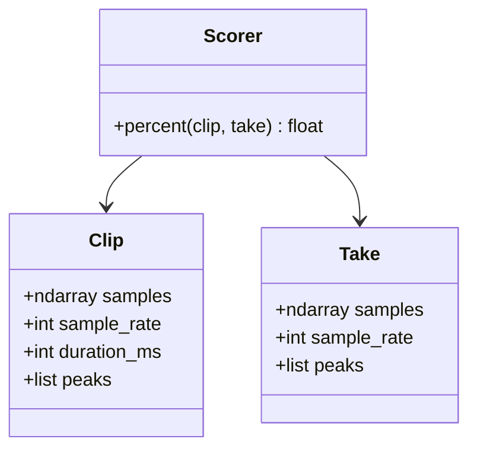

# Imitation test battery

A command, `python tests/battery.py`, scores [app/score.py](app/score.py) and prints the three rates. It does not fail the run when a case misses its prediction. Those misses are the errors the rates count. The same command then repeats the report for every older scorer.

Pass is a score at or above 50. [config.json](config.json) already has `threshold_percent` at 50, and that edit stays as it is. The battery does not write config. It decides at 50 for every revision, so an older commit whose config still says 70 is measured on the same line. FAR and FRR are reported at 50. EER is a separate sweep: the error rate where FAR and FRR meet. Because the score rises with agreement, a false rejection is a correct pair below the line, and a false acceptance is an incorrect pair on or above it.

The battery is a script. It builds a `Clip` and a `Take` and calls `Scorer.percent`. It does not add a class of its own. `Clip`, `Take`, and `Scorer.percent(clip, take)` have had this shape since `f537911`.

## Trials

Synthetic cases run once per file in the current `sounds/`. Every revision is given those same files. The reference is the file as stored. The battery does not cut the quiet lead-in.

- **The same sound.** The clip as the take. Correct. Predicted pass, about 100.
- **The same sound, lightly distorted.** The same samples at 0.15 gain. Correct. Predicted pass. This is the gain check already recorded in the score log.
- **Nothing.** Silence of the same length. Incorrect. Predicted fail, about 0.
- **Pure flat sound.** A 440 Hz tone of the same length. Incorrect. Predicted fail.
- **The same sound, started late.** 200 ms of silence in front, end trimmed so the length stays the clip length. 200 ms is past the 80 ms warp. Incorrect. Predicted fail.

Your recordings are not synthesized. Put them here, one folder per clip stem (`faaah`, `spongebob-fail`, `anime-wow-sound-effect`), and any audio name inside:

- `tests/recordings/<stem>/correct/` — correct imitation. Correct pair. Predicted pass.
- `tests/recordings/<stem>/incorrect/` — incorrect imitation. Incorrect pair. Predicted fail.
- `tests/recordings/<stem>/tapping/` — rhythmical tapping. Incorrect pair. Predicted fail.
- `tests/recordings/<stem>/breathing/` — breathing. Incorrect pair. Predicted fail.

Same extensions as the app: `.wav`, `.flac`, `.ogg`, `.mp3`. These folders stay out of `sounds/` so a round cannot play a take as a reference. A missing folder is printed and skipped. Synthetic trials still run, so FAR, FRR, and EER are defined before the recordings exist. The summary names which human rows were absent.

## Report

Each trial prints the clip, the case, the file name when there is one, the percent, and whether that agreed with the prediction. [Scorer.percent](app/score.py) already prints similarity and flatness; that line stays.

Then one summary:

- genuine count, impostor count
- FAR and FRR at 50, as a percentage and as a count (`0/9`)
- EER: sweep the line in 0.1 steps, take the step where `|FAR - FRR|` is smallest, and report the mean of the two rates there plus that threshold

## Loading

Do not add a loader to [app/audio.py](app/audio.py). `tests/battery.py` reads `.wav`, `.flac`, `.ogg`, and `.mp3` itself and builds `Clip` and `Take`. Recordings are not trimmed. `Scorer` only needs samples and sample rate.

No new markdown, no pytest dependency, and no change to the scoring math. Format the touched Python with Black.

## Rules

The battery is one Python file and the rates it prints. The class diagram above is the shape of `Clip`, `Take`, and `Scorer`. The script does not add another type.

Follow [.cursor/rules/](.cursor/rules/):

- [preserve-user-refactors.mdc](.cursor/rules/preserve-user-refactors.mdc). `threshold_percent` is already 50. Do not rewrite [config.json](config.json) or [app/score.py](app/score.py).
- [no-markdown-files.mdc](.cursor/rules/no-markdown-files.mdc). The recording folders are named in the module comment.
- [coding-conventions.mdc](.cursor/rules/coding-conventions.mdc). English names and printed sentences. Black at the default width of 88. The sample reader stays in the battery. Each historical run has to import that revision's own `app.audio`, so the battery cannot call a loader added to the current file.
- [inline-single-use.mdc](.cursor/rules/inline-single-use.mdc). A function used once in the file is inlined, with a comment on the number. The equal-error sweep stays named. It is the algorithm, and the rate at 50 uses the same comparison.
- [philosophy-of-software-design.mdc](.cursor/rules/philosophy-of-software-design.mdc). One script. No wrapper class, no pass-through loader, and no flags that expose the scorer.

## Git history

The repository has 11 commits. Five of them change [app/score.py](app/score.py): `f537911`, `8d71c34`, `38b4d9a`, `1028b2d`, and `6ea0134`. That is small enough to walk on every run. One command does it. A manual checkout is not required.

`python tests/battery.py` scores the working tree first, then each of those five commits. For a commit it writes that revision's `app/score.py` and `app/audio.py` into a temporary directory, starts a second Python process with that directory on the path, and deletes the directory when the process exits. The working tree is never checked out, so there is nothing to restore there. The current `sounds/` and `tests/recordings/` are passed by absolute path, and every revision scores those same files. Each report is labeled with the short commit id. Leave `tests/recordings/` untracked.
