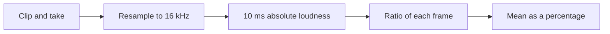

# Loudness similarity score

[`app/score.py`](app/score.py) stays the only scoring module. `Scorer.percent(clip, take)` stays the call from [`app/round.py`](app/round.py). The eight log bands, the FFT, the cosine, the flatness gate, and the 80 ms warp are deleted.

The score is the mean of one ratio per 10 ms frame. Pearson correlation is not used.

The take is already the length of the clip, so frames are compared at the same index. The 200 ms late start in [`tests/test_rates.py`](tests/test_rates.py) lays silence on the loud frames and cuts off the end. Those frames score near 0, and the mean falls under 50. A small human slip also lowers the score. Taps can still match a clip with the same loudness shape. The score log already records that, and this change accepts it.

Flatness is not part of the score. The breath passed the band scorer because a noise fills every band, and cosine only saw that the band vector pointed the same way. Loudness has no bands to fill.

## Loudness

Resample both sides to `GENERAL_RATE`, then one number per 10 ms: the mean of the absolute samples in that frame. No hop overlap, no window, no spectrum.

Rabiner and Sambur, "An Algorithm for Determining the Endpoints of Isolated Utterances," Bell System Technical Journal, vol. 54, no. 2, pp. 297–315, Feb. 1975. [IEEE Xplore 6778857](https://ieeexplore.ieee.org/document/6778857). Their frame energy is the sum of absolute samples over 10 ms. The mean is that sum divided by the fixed frame length. The paper uses the energy to find endpoints. This scorer uses the same energy as the whole description of the sound.

Called twice, so it stays `_loudness`.

## The ratio

Frame by frame, in order. Frame 1 of the imitation against frame 1 of the actual sound, frame 2 against frame 2, and so on. Nothing is divided by its own loudest frame.

Each frame is the smaller loudness divided by the larger one. A frame where the imitation is quieter than the actual sound scores that fraction. A frame where the imitation is louder stays inside 0 to 1 for the same reason. A frame where both are silent is left out of the mean, because the division is zero over zero. Counting those frames as a match would let a silent imitation score the quiet fraction of the actual sound, which can sit on the pass line of 50. If every frame is left out, the score is 0.

A quieter imitation of the same rises and falls scores lower. The microphone level is part of the ratio.

The percentage is that mean, times 100, rounded to one decimal. It is inlined in `percent`.

The late-start case has to come out under 50. The battery is the check. A clip whose loudness repeats every 200 ms could still agree with a copy of itself shifted by that much. If one does, the log says so.

## Other files

- [`README.md`](README.md), "A round" step 6: the score is the mean of the per-frame loudness ratios. A 200 ms late start falls under the pass line. In the score log, `1028b2d` is no longer "the scorer that is in the tree now." Add a working-tree entry with the battery rates. No invented commit hash.
- [`tests/test_rates.py`](tests/test_rates.py): the late-start comment says the shift misses the 80 ms warp. Change it so it says the loud frames no longer sit on each other, so the mean ratio drops. The case stays an impostor. No other test logic changes.
- [`app/round.py`](app/round.py), [`main.py`](main.py), and [`config.json`](config.json) stay as they are. The pass line remains 50.

Format with Black. Then run `python -m unittest tests.test_rates` and read `tests/battery.log`.
