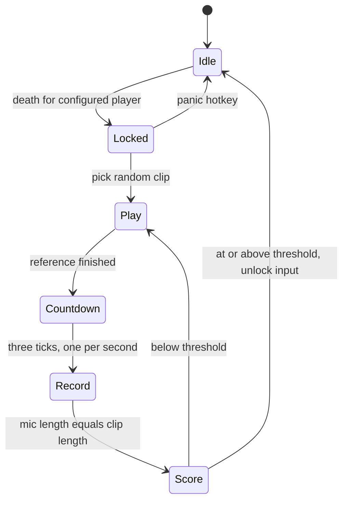

# Minecraft death sound challenge

Yes for phase 1. The overlay is an OBS Browser Source. It does not read the disk. Python owns the log, sounds, mic, score, and input lock, and pushes draw data to the page over a localhost WebSocket.

Those `.cursor/rules` files describe a Next.js CMS this repo does not have. This stays a local Python app plus one static overlay page: English identifiers, deep modules, no extra markdown files. No next-intl, no `web/` app.

## What you will run

One process: `python main.py`. On startup it seeks to the end of the live log (old deaths do not replay), serves the overlay, and waits.

Default log: `%APPDATA%\.minecraft\logs\latest.log`. Java Edition only. Chat, including deaths, is appended there as `[CHAT]` lines while the game is open. On launch Minecraft rotates that file; the tail detects a shrink and reopens it.

## Round

- Lock starts as soon as the death matches, so Minecraft cannot be clicked or moved until the take passes.
- Each attempt replays the same clip (so you hear it again), then the 3-second countdown, then a new recording. The live trace clears between attempts.
- Recording length equals the reference. The overlay x-axis is that duration, so the new trace sits on the same timeline.
- Headphones: the mic starts only after playback ends. Speakers can bleed into the take.

## Match score

Sample-by-sample correlation will not pass a mic take. Scoring in [`app/score.py`](app/score.py):

- Mono, about 16 kHz, loudness-normalized amplitude envelopes
- Silence trimmed on the take only
- Dynamic time warping so a slightly early or late imitation still aligns
- Correlation of the aligned envelopes, mapped to 0–100

`threshold_percent` in config, default 70. The number is shown on the overlay after each take. Expect to tune it once you have a few real clips; the raw score is printed in the console for that.

## Input lock

Windows low-level keyboard and mouse hooks via `ctypes` in [`app/input_lock.py`](app/input_lock.py). No admin prompt. The hook only filters; audio and scoring stay off the hook callback.

- `Ctrl+Alt+Del` still works at the OS level.
- Panic chord `Ctrl+Shift+Esc` is let through, uninstalls the hook, and aborts the round. Configurable.
- `try/finally` plus `atexit` always unhooks. If the process dies, Windows drops the hook and input returns.
- Keys already held when the lock starts can stick inside Minecraft until the next key event. Death is usually a respawn screen, so this is acceptable for v1.

## OBS overlay

Browser Source URL `http://127.0.0.1:8765`, size about 1920×280, transparent background, no custom CSS required in OBS.

[`overlay/index.html`](overlay/index.html), [`overlay/styles.css`](overlay/styles.css), [`overlay/overlay.js`](overlay/overlay.js):

- While the reference plays: bright original waveform
- On record: that waveform turns grey and stays fixed; mic peaks append in color at ~20 Hz
- Countdown: large 3, 2, 1
- After a take: the percentage; on a fail, short hold, then the live layer clears and the clip replays
- Idle: empty transparent page so the source is invisible between rounds

## Config

[`config.json`](config.json) (created on first run if missing):

- `player_name` — death lines that start with this name
- `log_path` — override; default is the Java `latest.log`
- `sounds_dir` — random clip from wav, flac, ogg, or mp3
- `countdown_sound` — played once per countdown second; if omitted, a short synthesized tick
- `threshold_percent`, `countdown_seconds`, `overlay_port`
- `input_device` / `output_device` — null means the Windows default; `python main.py --list-devices` prints names
- `extra_patterns` — extra regexes for non-English or plugin death text

Built-in matcher ignores ordinary chat (`<Name> ...`) and advancement lines (`has made the advancement`). It accepts vanilla English death wording (`was slain by`, `fell from a high place`, `drowned`, and the rest of the vanilla set). Another language needs patterns in `extra_patterns`.

## Modules

- [`app/log_tail.py`](app/log_tail.py) — follow `latest.log`, yield new `[CHAT]` text
- [`app/deaths.py`](app/deaths.py) — player death match
- [`app/audio.py`](app/audio.py) — load, play, countdown ticks, chunked mic record
- [`app/score.py`](app/score.py) — envelope, DTW, percent
- [`app/input_lock.py`](app/input_lock.py) — hook lock as a context manager
- [`app/overlay_server.py`](app/overlay_server.py) — static page plus WebSocket broadcast
- [`app/round.py`](app/round.py) — the state machine above; one round at a time, further deaths ignored until it ends
- [`main.py`](main.py) — config, devices flag, wire the tasks

Dependencies: `sounddevice`, `soundfile`, `miniaudio` (mp3), `numpy`, `scipy`, `websockets`. Audio I/O runs on a worker thread so the overlay keeps updating during playback and recording.

## Out of this phase

No desktop GUI, no Bedrock log, no retry limit, no second overlay theme. The console plus the OBS source is the whole UI.
