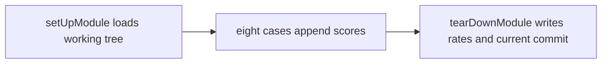

# Simplify the rates battery

You are loading an older version because [`tearDownModule`](tests/test_rates.py) checks out every commit that touched `app/score.py`, then starts a child process with `BATTERY_APP` set. Lines 28–33 put that checkout on `sys.path`, so the child imports old `app/` instead of the working tree. The log path, the revision global, the copied `_load_samples`, and the append-mode log all exist to support those children.

That runner goes away. One run scores the working tree and overwrites [`tests/battery.log`](tests/battery.log).



## Stop replaying old commits

In [`tests/test_rates.py`](tests/test_rates.py):

- Delete `_run_without_progress` and `TextTestRunner.run = _run_without_progress`. Default unittest output is enough.
- Delete the `BATTERY_APP` branch. Keep `sys.path.insert(0, str(ROOT))` so `app` still imports when the file is launched as a script. That insert is the working tree, not an old checkout.
- Delete `_LOG_PATH`, `_REVISION`, `BATTERY_LOG` / `BATTERY_REVISION`, append mode, and the child-process loop at the bottom of `tearDownModule` (`tempfile`, `git show`, re-exec).
- Open the log in `setUpModule` at `ROOT / "tests" / "battery.log"` in `"w"`. No path variable and no environment override.
- Delete `_revision_label`. Its one remaining `git log -1 --format=%h %s` is written in `tearDownModule` with the summary. The other `git log` (every `app/score.py` commit) is the runner being removed, so the two calls become that single label read.
- Summary stanza, after the trials:

```text
revision d014655 testing-refactor-wip
genuine=9 impostor=15
FAR=46.7 (7/15) at 50
FRR=11.1 (1/9) at 50
EER=24.4 at 57.7
```

The terminal line stays one rates line, using that same local label. Nothing is stored in `_REVISION`. [`tests/battery.log`](tests/battery.log) is generated; the next run overwrites it. Do not hand-edit the old blocks.

Update the module docstring so it no longer describes per-commit reruns or `recordings/<stem>/plausible/`.

## One sample loader

Import `_load_samples` from [`app/audio.py`](app/audio.py) and delete the copy in the test. It was copied only so old checkouts would decode audio the same way.

Move the empty-file check into that function, after both decode paths, and delete the three copies in the test (`setUpModule`, `_shared`, `test_plausible`) plus the same check in `AudioSession.pick_random`:

```python
if samples.size == 0 or rate <= 0:
    raise RuntimeError(f"Could not read audio from {path}")
```

An empty clip in the app then raises `RuntimeError` instead of `SystemExit`. The condition lives in one place.

## Recordings are flat files

Move these up so the stem is the name. `breathing.wav` and `tapping.wav` already sit there:

- `tests/recordings/faaah/plausible/faaah.mp3` to `tests/recordings/faaah.mp3`
- `tests/recordings/spongebob-fail/plausible/spongebob-fail.wav` to `tests/recordings/spongebob-fail.wav`
- `tests/recordings/anime-wow-sound-effect/plausible/anime-wow-sound-effect.wav` to `tests/recordings/anime-wow-sound-effect.wav`

Remove the emptied directories. A recording whose stem matches a clip is that clip's plausible take. `test_plausible` looks up the stem in `tests/recordings/` and logs `missing <stem>` when it is missing. or absent decide which naming convcention is better `_shared` uses the same lookup for `breathing` and `tapping`.

## Inline what has one job at the call site

- `**_audio_files`: inline it. Sorting paths does not change any score. FAR, FRR, and EER are aggregates, and [`_eer`](tests/test_rates.py) already sorts the numeric scores it sweeps. A threshold grid search would use those score lists, not file order. Drop `sorted`. Log lines may follow directory order.
- `**_rates`:_ keep the two counts here (both `_eer` and `tearDownModule` need them). Delete the two `100.0 _ count / len(...)` lines and write those at the two call sites.
- `**_log`: delete it. Call sites print straight to the log file. `setUpModule` opens it before any trial, so the `None` guard has nothing to protect.
- `**_eer` and `_shared` stay. `_eer` is the algorithm. `_shared` has two callers. A stem lookup used by both `_shared` and `test_plausible` stays one function, placed above them. `_AUDIO_EXTENSIONS` stays, since both the sounds listing and that lookup need it.

Drop imports that only served the deleted runner: `os`, `tempfile`, `warnings`, `soundfile`, `TextTestRunner`, `registerResult`. Keep the comment on `_GENUINE` / `_IMPOSTOR`.

Format touched Python with Black at the default 88 columns.
